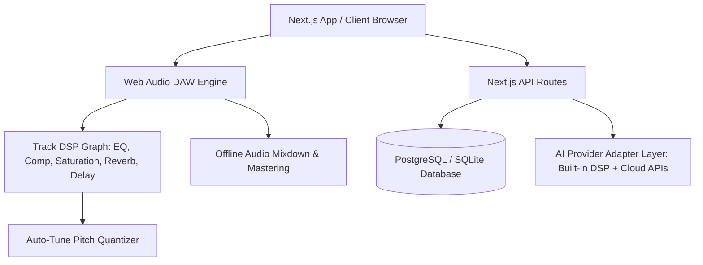

# AURA RAP STUDIO – SYSTEM ARCHITECTURE

## 1. High-Level System Overview



---

## 2. Audio Processing Architecture

### Real-Time Multitrack Graph
Each audio track in the timeline is routed through an isolated `TrackDSPNode` graph:

```
[AudioBufferSourceNode] 
      │
      ▼
[BiquadFilterNode (HighPass 20-350Hz)]
      │
      ▼
[3-Band Parametric EQ (LowShelf 250Hz, Peaking Mid 2.5kHz, HighShelf 8kHz)]
      │
      ▼
[DynamicsCompressorNode (Threshold, Ratio, Attack, Release, Knee)]
      │
      ▼
[WaveShaperNode (Hyperbolic Tangent Analogue Saturation Curve)]
      ├─── Send ──► [ConvolverNode (Algorithmic Plate/Booth Reverb)] ──► Return
      ├─── Send ──► [DelayNode + BiquadFilter (Ping-Pong Stereo Delay)] ──► Return
      │
      ▼
[GainNode (Track Volume)] ──► [StereoPannerNode (-1.0 to +1.0)]
      │
      ▼
[Master Bus: Master Gain ──► Master Limiter ──► AnalyserNode ──► Destination]
```

### Offline Mastering & Stem Rendering
The `OfflineAudioContext` engine renders sample-accurate mixdowns for commercial release:
- Supports 44.1kHz and 48kHz native sample rates.
- Multi-channel bit depth conversion:
  - **16-bit PCM:** Redbook CD / standard distribution.
  - **24-bit PCM:** High-resolution mastering standard.
  - **32-bit IEEE Float:** Unclipped mixing stem format.
- Real-time EBU R128 / ITU-R BS.1770 K-weighted Integrated LUFS loudness calculation and True Peak metering with 4x oversampling.

---

## 3. Database & Storage Architecture
- **ORM:** Prisma Client with relational schema.
- **Development Database:** Local SQLite (`dev.db`) initialized with zero external setup.
- **Production Database:** PostgreSQL (Neon Serverless Postgres ready with connection pooling).
- **Audio Assets:** Large media files are kept as ArrayBuffers in Web Audio memory and stored in persistent object storage (`/public/uploads` or S3/GCS buckets), storing only asset references and peak metadata in the database.

---

## 4. AI Adapter Pattern
The AI Producer is designed with modular adapters to prevent vendor lock-in:
- **Built-in Procedural Engine (`builtin`):** Operates without API keys or internet connection. Synthesizes 808 sub bass, punchy kicks, trap claps, and rolling hi-hats.
- **External Providers (`replicate`, `suno`, `elevenlabs`):** Configurable in `.env` or studio settings with clean fallback handling when keys are not configured.
