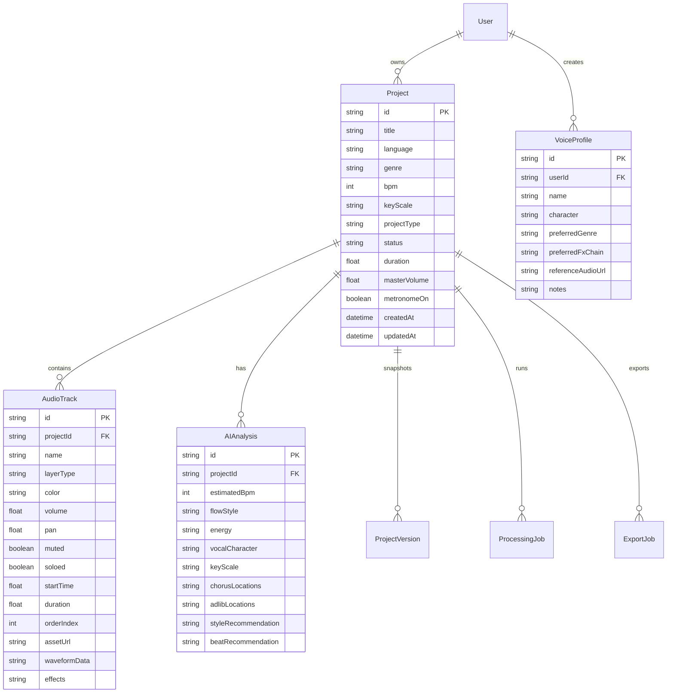

# AURA RAP STUDIO – DATABASE SCHEMA

Managed via Prisma ORM.

## Entity-Relationship Diagram

## Schema Entities Summary
- **User:** Account & authorization management.
- **Project:** Multitrack workspace metadata, tempo, key, and transport state.
- **AudioTrack:** Track lane definitions, timeline positions, volume/pan, and serialized DSP FX chains.
- **Beat:** Royalty-free beats and AI-generated stems.
- **AIAnalysis:** Real audio flow analysis logs (BPM, cadence, energy).
- **VoiceProfile:** Human voice timbre profile and favorite rap mixing presets.
- **ProjectVersion:** Version snapshots for backup and project rollback.
- **ExportJob & ProcessingJob:** Background audio processing and export tracking.
